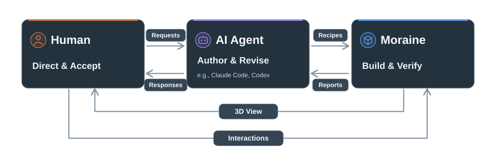

# Moraine

[English](README.md) | 日本語

<p>   </p>

Moraine は、リアルタイム 3D アセット向けの AI ネイティブなプロシージャルモデリングツールです。AI エージェントとともに 3D アセットを組み立て、作り込み、拡張することができます。エージェントがレシピを書き、テストが要件を検証し、あなたがどんなアセットにするかを決めます。

作りたいものをエージェントに伝えてください。モデリングの手順を指示する必要はありません。ビューアで部品を指して変更を頼んだり、バリエーションを試したり、作ったアセットをより大きなものに組み込んだりすることもできます。変更のたびに Moraine がジオメトリを処理し、宣言した要件を検証するので、一から作り直すのではなく、作ったアセットを育てていけます。



## 組み立て、作り込み、拡張

### 組み立て（Build）

作りたいものと、必ず守ってほしい条件を伝えると、エージェントがレシピを書きます。レシピは Python に似た言語である [Starlark](https://github.com/bazelbuild/starlark) のスクリプトで、オペレーション（プリミティブ、カット、配列、配置、マテリアルなど）のグラフを定義したものです。寸法やパーツ同士の接触など指定した要件は、人間が管理する別のファイルに記録されます。ツールはレシピからジオメトリを生成し、要件を検証して、その結果をフィードバックします。エージェントはすべての要件を満たすまでレシピの修正を繰り返し、あなたがビューアで仕上がりを判断します。下の宇宙船の通路は、配管、照明器具、ロッカー、天井機器を備えた同じモジュールを 5 つ並べたものです。ツールは、通路内部の有効幅 2.0 m と有効高さ 2.4 m という 2 つの要件を検証します。


*レシピ。エージェントが書くので、手での編集は必要ない。この抜粋は通路の床を作って配置する箇所。*

```python
deck_box = mo.box(
    id = "deck_box",
    size = [
        BORE_W - 2 * (RIB_DEPTH + DECK_GAP),
        DECK_T,
        MODULE_LEN - 2 * DECK_END_GAP,
    ],
)
deck_on_floor = mo.place(
    hull_floor, deck_box,
    id = "deck_on_floor",
    anchor = "bore_floor",
    mode = "on_top",
)
```

<br clear="all">

### 作り込み（Refine）

アセット制作では、作ってからの調整や作り込みが作業の大半を占めます。その指示をビューアから出せます。手を加えたい場所をピンで指し、どう変えたいかをエージェントに伝えてください。エージェントはピンの情報から対象の部品を特定し、その部品を定義するレシピを修正します。変更後もツールが要件を検証するので、あなたは更新されたモデルを見て、採用するかどうかを決めてください。下の例では、天井機器のボックスを 1 つピン留めし、エージェントに変更を依頼しています。自分で調整したいパラメータも、ビューアのパネルから操作できます。床の表面の粗さのスライダー、汚れのシードの引き直し、ロッカーの数の増減などです。Accept ボタンを押すと、選んだ値がアセットに保存され、ツールがその値で要件をもう一度検証します。

<table>
<tr>
<td width="50%"></td>
<td width="50%"></td>
</tr>
<tr>
<td><em>Before: ビューアでピン留めした、装飾のない機器ボックス。依頼は「ここに金属製の通気口かグリルを追加して」。</em></td>
<td><em>After: すべてのボックスにファングリルが取り付けられ、側面にはルーバーが追加された。同じカメラ視点での比較。</em></td>
</tr>
</table>

### 拡張（Extend）

完成したアセットは、次のアセットを作るための部品になります。部品は参照によって再利用でき、公開されたパラメータの値をオーバーライドできるため、1 つの部品からさまざまなバリエーションを作ることが可能です。元のアセットで宣言した要件も引き継がれます。部品同士の接続にも新たな要件を宣言でき、ツールは元の要件とあわせて検証します。下の与圧ハブは、先ほどの通路を参照して 3 本のアームを構成しているアセットです。ロッカーの数、設置機器、汚れ具合をアームごとに変えています。通路内部の有効幅と有効高さの要件はどのアームにも引き継がれます。さらに、各アームとハブの接続部では、アームの外殻がハブのポートに正しく据え付けられていること、床同士が境目で接していることが新たな要件として検証されます。

<table>
<tr>
<td width="50%"></td>
<td width="50%"></td>
</tr>
<tr>
<td><em>ハブ。1 つの通路を 3 本のアームとして再利用し、それぞれに異なるパラメータ値を設定している。作り込みで追加したグリルも、すべてのアームに反映されている。</em></td>
<td><em>ハブの内側から見たアームとの接続部。ここで新たに宣言した要件も、通路から引き継いだ要件とあわせて検証される。</em></td>
</tr>
</table>

**ジャーナル:** エージェントはプロジェクトごとにジャーナルを残し、設計上の判断の理由、採用しなかった案、修正を通じて伝えたことを記録します。エージェントは作業を始める前にジャーナルを読むため、過去の判断が次の作業にも引き継げます。セッションや担当者が変わっても、経緯を踏まえて制作を続けられる仕組みです。通路のジャーナルには、幅を 2.0 m にした理由が「2 人がすれ違えるようにするため」と記録されています。また、最初のグリル案はアセットのポリゴン数を倍以上に増やしてしまったため採用されず、エージェントが提案した 4 つのよりシンプルな案から、作者が大きめのファンを 1 基使う案を選んだことも書かれています。

## パストレーサでレンダリング

完成したアセットは、マテリアルとインスタンシングを保ったまま glTF 2.0 でエクスポートできます。

これらの画像は、上のアセットからエクスポートしたファイルをパストレーサでレンダリングしたものです。エージェントが作ったマテリアル、法線マップ、発光面をそのまま使用しています。


*ハブの内部。ガラス屋根、光のリング、2 本のアーム。*


*湖のジオラマ。水面に映る峰と、両岸の針葉樹林。*

## 使い始める

必要なもの:

- ファイルの編集とターミナルでのコマンド実行ができる AI コーディングエージェント(Claude Code や Codex など)。
  - 同じことができればどのエージェントでも使えます。Moraine 自体はモデルを呼び出しません。
- Windows または Apple シリコンの macOS と、Python 3.12 以降。
  - 依存パッケージはすべてバイナリ wheel で配布されているので、コンパイルは不要です。

Moraine は一度インストールすれば、どのワークスペースからでも使えます。

```bash
uv tool install moraine3d
```

```bash
moraine init my-workspace
cd my-workspace
```

`init` は、自分のルールを書く `AGENTS.md` と、エージェント向けのオーサリングガイドを含むワークスペースを用意します。`AGENTS.md` は英語で用意されますが自分のファイルなので、エージェントに翻訳してもらい、ルールを日本語で書くこともできます。エージェント向けのオーサリングガイドは英語のままです。ワークスペースをエージェントで開いたら、[Tour](docs/tour.ja.md) に沿って最初のアセットを作ってみてください。短い依頼から glTF のエクスポートまでできます。

同梱の [Skill](skills/moraine/SKILL.md) でこのセットアップを行うこともできます。

- **Claude Code:** `/plugin marketplace add ms-elk/moraine`、`/plugin install moraine@moraine` の順で実行してください。
- **Codex:** `codex plugin marketplace add ms-elk/moraine`、`codex plugin add moraine@moraine` の順で実行してください。

そのあと、新しいセッションで、ワークスペースにしたいディレクトリに Moraine をセットアップするようエージェントに頼んでください。

## サンプルワークスペース

[ms-elk/moraine-sample-workspace](https://github.com/ms-elk/moraine-sample-workspace) は、再利用可能なアセットを組み合わせて鉄道駅のシーンを構築した、Moraine のワークスペースです。レシピ、人間が定めた要件、依頼内容、ジャーナルが揃っており、制作から改良までの過程が 1 ラウンド 1 コミットで記録されています。

ビューアでアセットを確認して、エージェントに変更を頼んでみてください。Moraine がその結果を宣言された要件に照らして検証します。

## ドキュメント

| ドキュメント | 内容 |
|---|---|
| [Tour](docs/tour.ja.md) | 最初のアセットを、依頼から glTF のエクスポートまで |
| [Examples](docs/examples.md) | 同梱のサンプル、箱ひとつからテクスチャ付きの建物や散布フィールドまで（英語） |
| [Reference](src/moraine3d/docs/reference/) | アセット形式、オペレータとアサーション、CLI、ジャーナル（英語） |
| [Agent guide](src/moraine3d/docs/guide.md) | エージェントが作業前に読む文書（英語） |
| [DESIGN](DESIGN.md) | Moraine の設計文書（英語） |

## ライセンス

Apache-2.0。詳細は `LICENSE` を、同梱のサードパーティソフトウェアは `THIRD_PARTY_NOTICES.md` を参照してください。
