# Moraine

English | [日本語](README.ja.md)

Moraine is an AI-native procedural modeling tool for real-time 3D
assets. It lets you build, refine, and extend 3D assets together with
an AI agent — the agent writes the recipe, tests verify your declared
requirements, you decide what they become.

Tell your agent what you want to build, not how to model it. Point
at a part in the viewer and ask for a change, explore variations,
or reuse the asset in something larger. Moraine handles the
geometry and verifies your declared requirements as the asset
evolves, so you can keep building on what you've made instead of
starting over.

<p>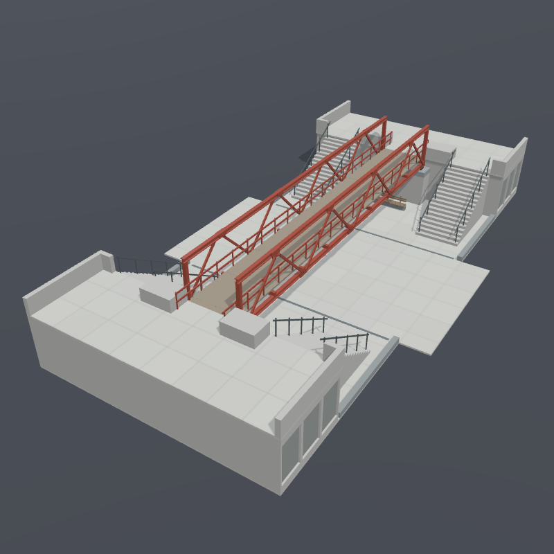 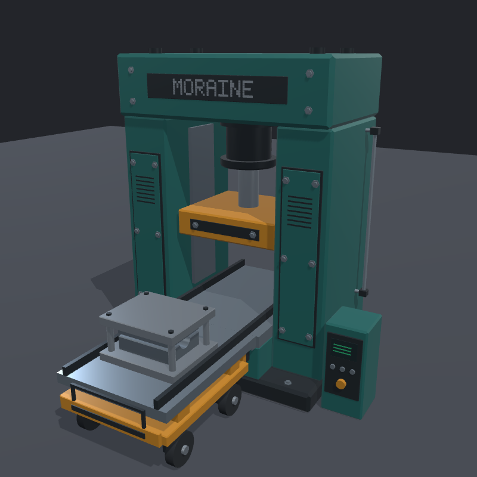 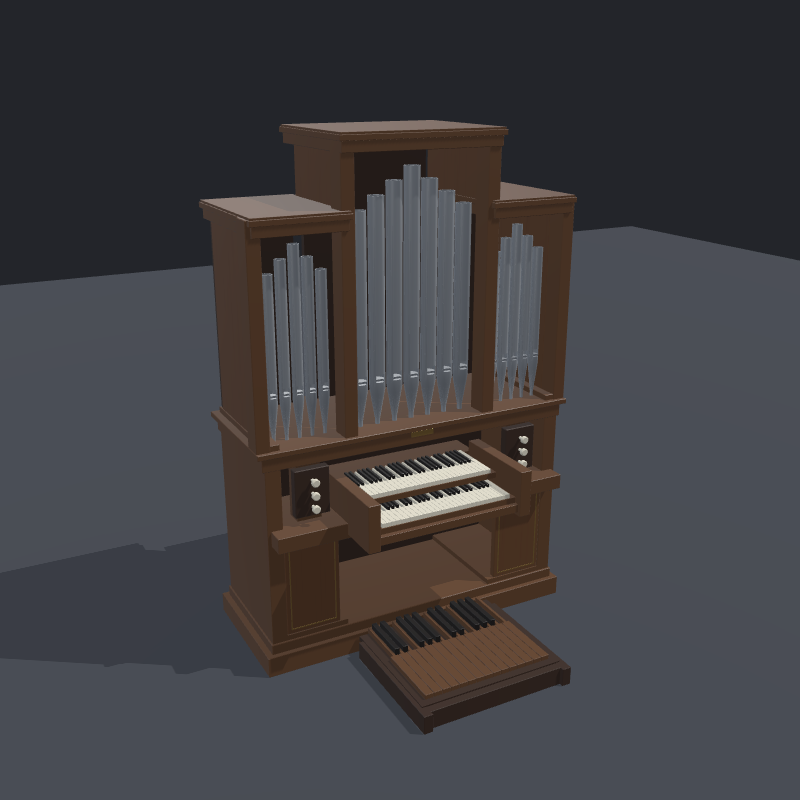 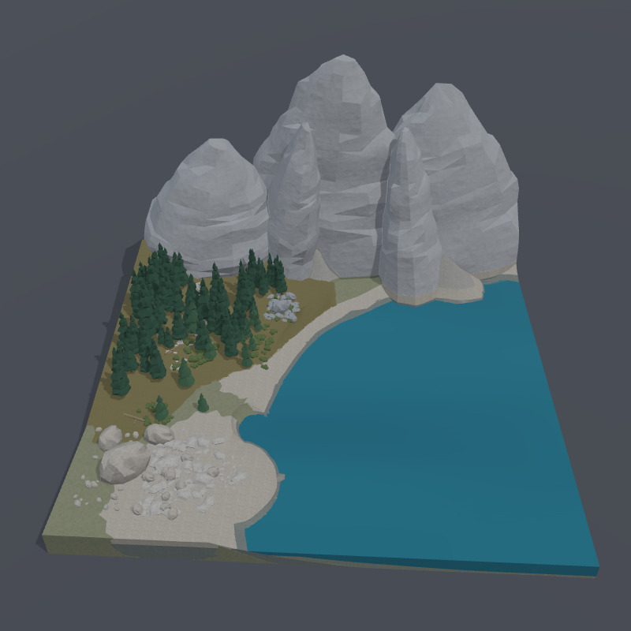</p>

## Build, Refine, Extend

### Build

You describe what you want to build and what must hold, and the
agent writes the recipe: a script in
[Starlark](https://github.com/bazelbuild/starlark), a Python
dialect, that defines a graph of operations such as primitives,
cuts, arrays, placements, and materials. Your declared requirements,
dimensions and contacts among them, are kept in a separate,
human-owned file. The tool generates the geometry, verifies the
requirements, and feeds the result back. The agent edits the recipe
until every requirement passes, and you judge the result in the
viewer. The modular spaceship corridor below is one module placed
five times, with pipes, light fixtures, lockers, and roof equipment.
The tool verifies its two declared requirements: a clear bore width
of 2.0 meters and height of 2.4 meters.

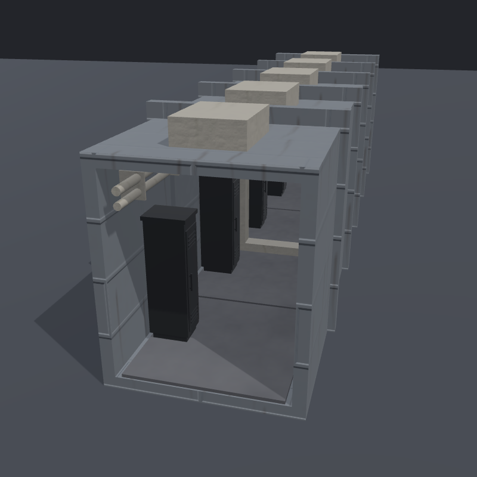

*The recipe, as the agent writes it. No hand editing needed. This excerpt creates and places the corridor's deck.*

```python
deck_box = mo.box(
    id = "deck_box",
    size = [
        BORE_W - 2 * (RIB_DEPTH + DECK_GAP),
        DECK_T,
        MODULE_LEN - 2 * DECK_END_GAP,
    ],
)
deck_on_floor = mo.place(
    hull_floor, deck_box,
    id = "deck_on_floor",
    anchor = "bore_floor",
    mode = "on_top",
)
```

<br clear="all">

### Refine

Most of the work is refinement, and you can direct it from the
viewer. Pin the spot you want to work on and tell the agent what
should change there. The agent reads the pinned part and updates
the recipe where that part is defined. After the change, the tool
still verifies the requirements, and you inspect the updated model
and decide whether to accept it. Below, the human pinned one of the
roof equipment boxes and said what to do with it.
Parameters you want in your own hands go on a panel in the viewer.
Drag the deck's roughness, reroll a wear seed, or step the locker
count. The Accept button makes your pick part of the asset, and the
tool verifies the requirements again under the value you chose.

<table>
<tr>
<td width="50%">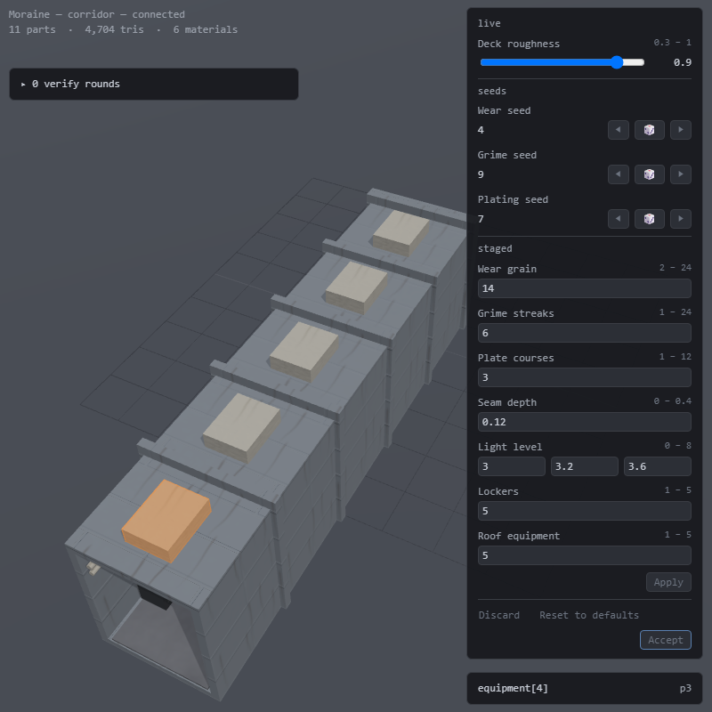</td>
<td width="50%">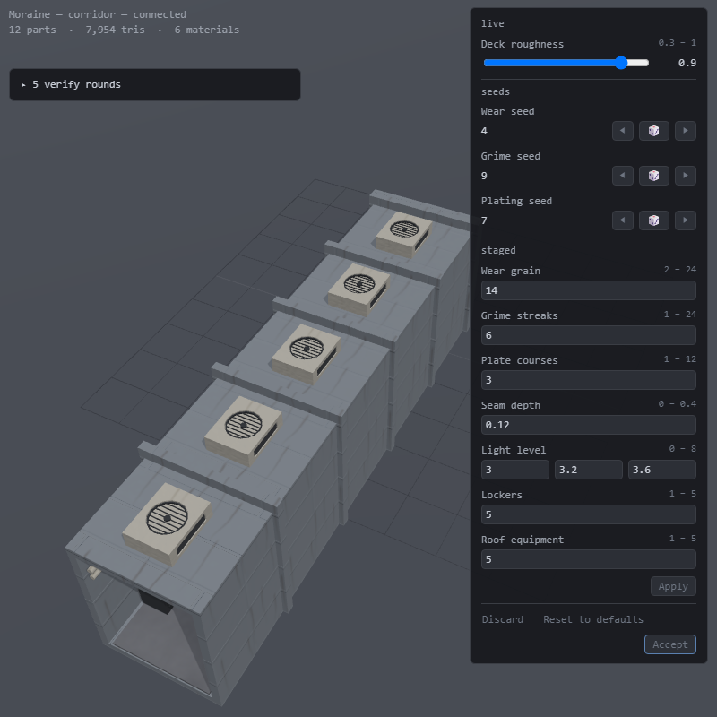</td>
</tr>
<tr>
<td><em>Before: a plain equipment box, pinned in the viewer. The request: add vents or a grille to it, in a metal material.</em></td>
<td><em>After: a fan grille set into every box, with louvers on the sides. The same camera view.</em></td>
</tr>
</table>

### Extend

A finished asset becomes a building block for the next. You can
reuse a part by reference and override the knobs it exposes, so one
part yields a family of variants. Its declared requirements travel
with it. You can also declare requirements for how the parts
connect, and the tool verifies them alongside the original
requirements. The pressurized hub below grows three arms from the
corridor, each with its own locker count, equipment, and wear. The
bore width and height requirements carry into every arm. New
requirements are verified where each arm docks into the hub: that
the shell seats on its port and the decks meet at the threshold.

<table>
<tr>
<td width="50%">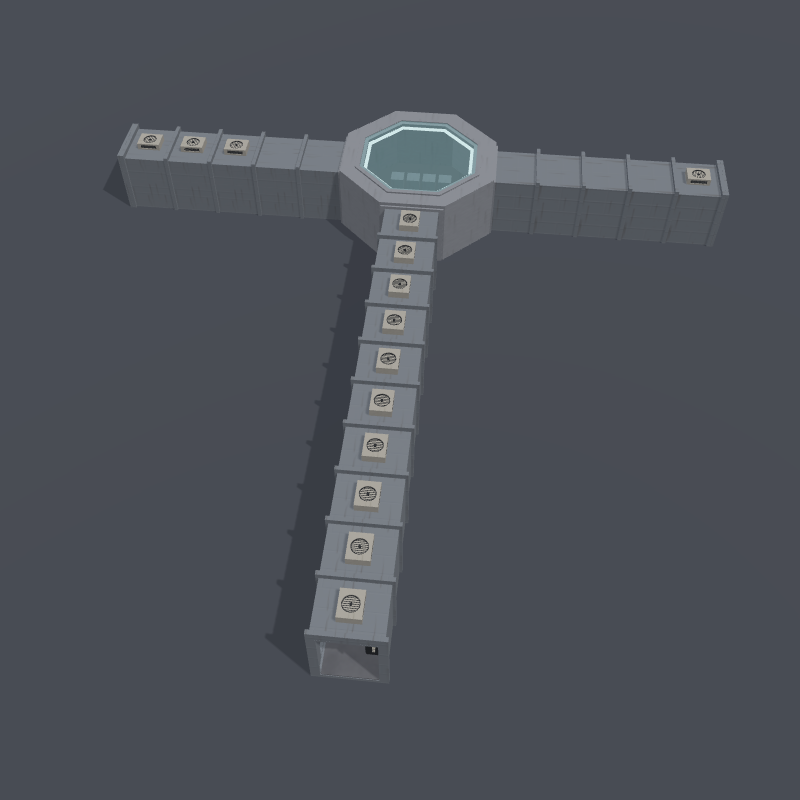</td>
<td width="50%">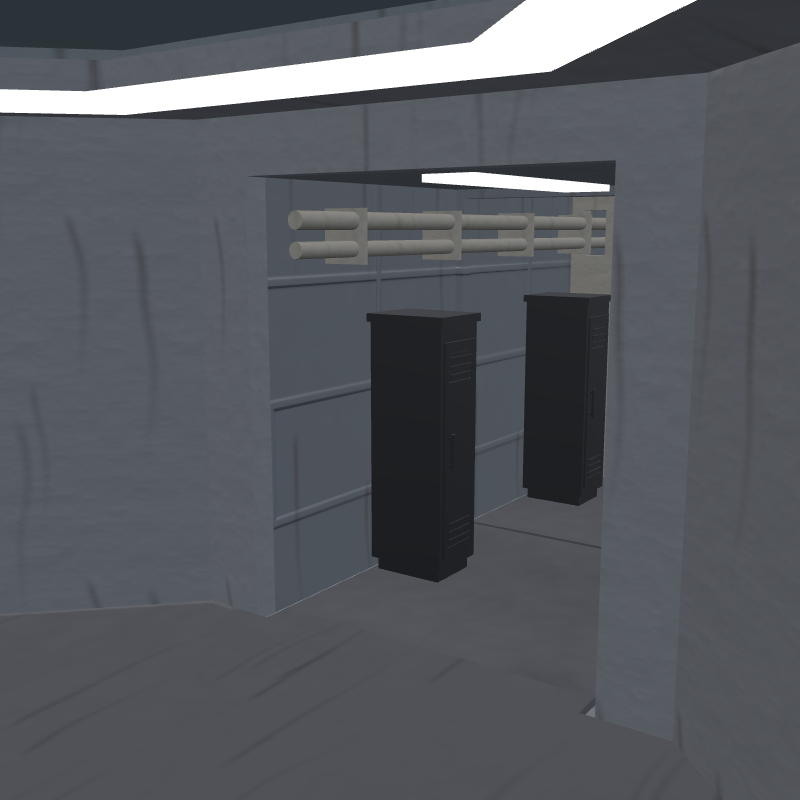</td>
</tr>
<tr>
<td><em>The hub: one corridor, reused three times by reference, each arm with knob values of its own. The grilles added during refinement appear on every arm.</em></td>
<td><em>Where an arm docks into the hub, seen from inside. The new requirements at this joint are verified alongside those carried from the corridor.</em></td>
</tr>
</table>

**Journal:** The agent keeps a journal for each project, recording
why design choices were made, which variants you rejected, and the
corrections you made. The agent reads the journal before working,
so your earlier decisions shape the next round, and future sessions
or colleagues can continue the work instead of starting over. The
corridor's journal records why the bore is 2.0 m wide — to let two
people pass — and why the first grille design was rejected: it more
than doubled the triangle count, so the agent proposed four simpler
alternatives and the human chose one larger fan.

## Rendering with a path tracer

Finished assets export as glTF 2.0 with materials and instancing
preserved.

These images were rendered with a path tracer from the exported
files of the assets above, with the agent-authored materials, normal
maps, and emissive surfaces intact.

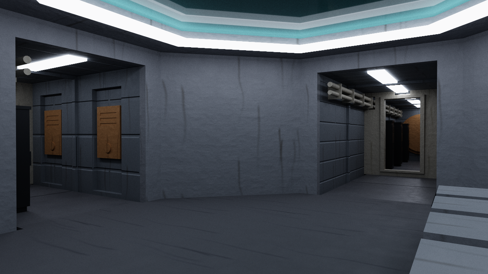

*Inside the hub: the glazed roof, the light ring, and two of the
arms.*

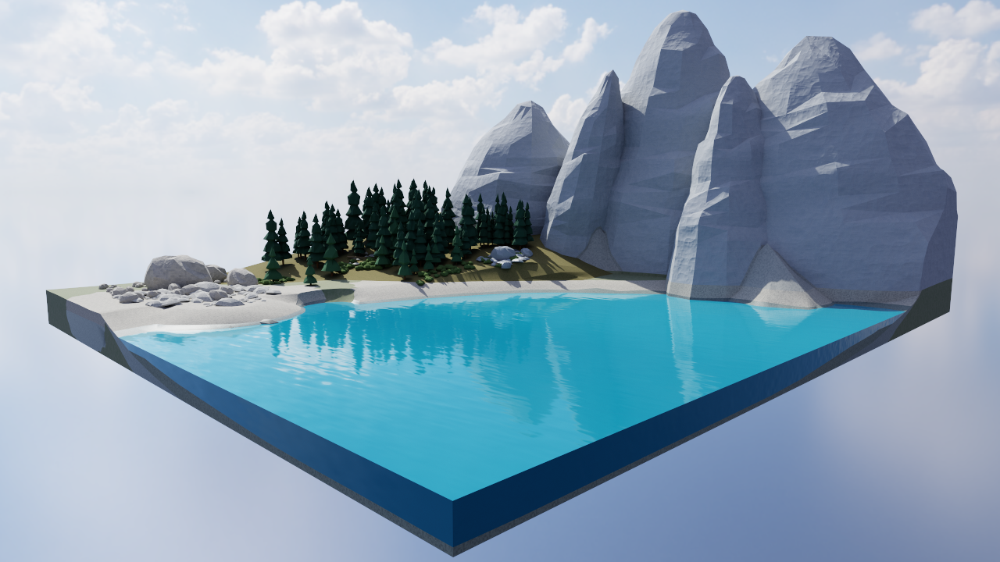

*The lake diorama: the rock wall and the conifers reflected in the
water.*

## Get started

You need:

- An AI coding agent that can edit files and run commands in a
  terminal, such as Claude Code or Codex.
  - Any such agent works, and Moraine itself calls no model.
- Windows, or macOS on Apple silicon, with Python 3.12 or later.
  - Every dependency ships as a binary wheel, so there is nothing to
    compile.

Install Moraine once and use it from every workspace:

```bash
uv tool install moraine3d
```

```bash
moraine init my-workspace
cd my-workspace
```

`init` scaffolds a workspace with `AGENTS.md` for your rules and the
authoring guide for the agent. `AGENTS.md` ships in English and is
yours: ask the agent to translate it, and write your rules in your
own language. The authoring guide for the agent remains in English.
Open the workspace in your agent, then follow the
[tour](docs/tour.md) to build your first asset, from a short request
to a glTF export.

With Claude Code, the shipped [skill](skills/moraine/SKILL.md) can
do this setup for you: run `/plugin marketplace add ms-elk/moraine`,
then `/plugin install moraine@moraine`.

## Sample workspace

[ms-elk/moraine-sample-workspace](https://github.com/ms-elk/moraine-sample-workspace)
is a complete Moraine workspace built around a railway station
scene assembled from reusable assets. It includes the recipes, the
human-defined requirements, journals, and requests, with one commit
per round documenting how the kit was built and refined.

Explore the assets in the viewer, then ask your agent for a change.
Moraine verifies the result against the declared requirements.

## Documentation

| Document | What it covers |
|---|---|
| [Tour](docs/tour.md) | Your first asset, from a request to a glTF export |
| [Examples](docs/examples.md) | Shipped examples, from a single box to textured buildings and scatter fields |
| [Reference](src/moraine3d/docs/reference/) | The asset format, the operators and assertions, the CLI, the journal |
| [Agent guide](src/moraine3d/docs/guide.md) | What the agent reads before authoring |
| [DESIGN](DESIGN.md) | Moraine's design document |

## License

Apache-2.0. See `LICENSE`. Bundled third-party software is listed in
`THIRD_PARTY_NOTICES.md`.
