# Examples

Twenty-one sample projects, each a recipe authored by the modeling
agent from a one-paragraph request, kept validate-green by the test
suite. The assets live in the package, under
[src/moraine3d/docs/examples/](../src/moraine3d/docs/examples/), so
every install ships them (`moraine docs examples` prints this index
without the pictures, `moraine docs examples/<name>` an asset, and an
op's section the asset it cites). To run one, copy it into the
repository's ignored working area, `scratch/`, since serving and
exporting write beside the asset:

```
cp -r src/moraine3d/docs/examples scratch/examples
moraine validate scratch/examples/<name>     # checks + asserts, terse JSON
moraine serve scratch/examples/<name>        # viewer with file watch
```

Each row names what the project demonstrates and why it is in the
repository: an **operator** example is the asset `moraine docs <op>`
cites as the contract illustration for that operator; a **showcase**
is a complete small asset; a **convention** check pins one of the
normative conventions. Where a project carries asset assertions, the
acceptance criteria are its `mo.assert_*` calls, the human's in
its requirements file.

Every thumbnail is the viewer's own `iso` view, rendered by the tool
itself — `moraine serve scratch/examples/<name>`, then
`moraine screenshot scratch/examples/<name> -o docs/images/examples/<name>.png`
(from the working copy above).

| Project | Demonstrates | Operators | Role |
|---|---|---|---|
| [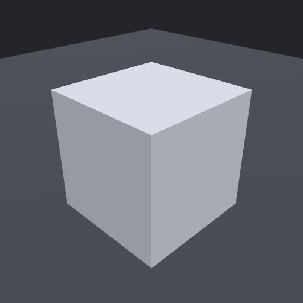](../src/moraine3d/docs/examples/box/box.star)<br>[box](../src/moraine3d/docs/examples/box/box.star) | The smallest asset: one box resting on the ground plane. Start here. | box, transform | starting point |
| [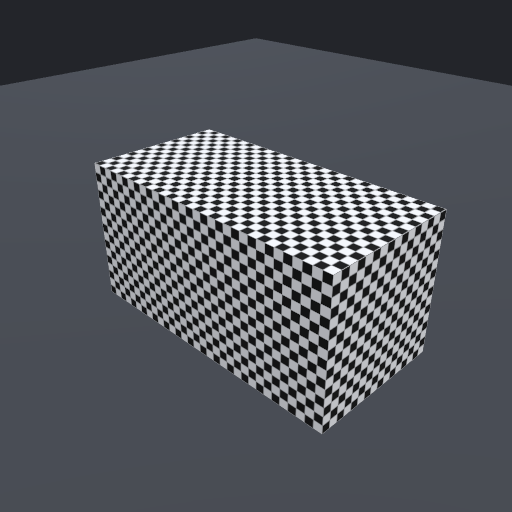](../src/moraine3d/docs/examples/uv_check/uv_check.star)<br>[uv_check](../src/moraine3d/docs/examples/uv_check/uv_check.star) | Checker texture on a box-unwrapped box, for reading the UV convention (v-down, top-left origin) in the viewer. | unwrap, checker_texture, material | convention; operator (checker_texture) |
| [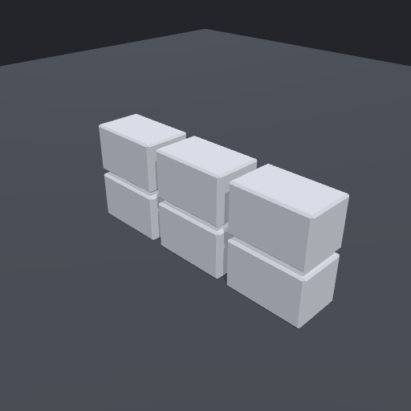](../src/moraine3d/docs/examples/crate/crate.star)<br>[crate](../src/moraine3d/docs/examples/crate/crate.star) | Bevel → box unwrap → nested instanced arrays: a 3 × 2 crate kit from one prototype. | bevel, unwrap, array | showcase |
| [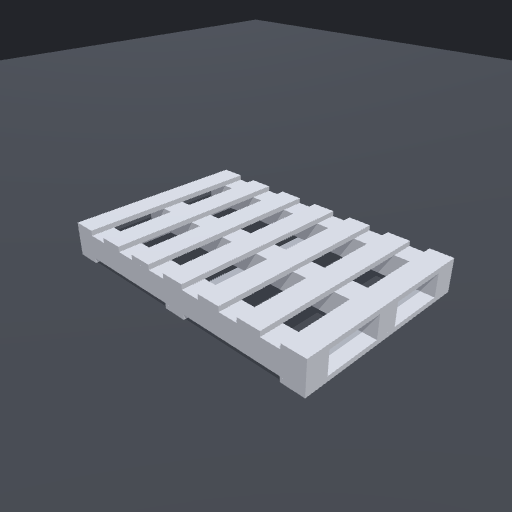](../src/moraine3d/docs/examples/pallet/pallet.star)<br>[pallet](../src/moraine3d/docs/examples/pallet/pallet.star) | Stringer pallet, every board instanced. | box, array | showcase |
| [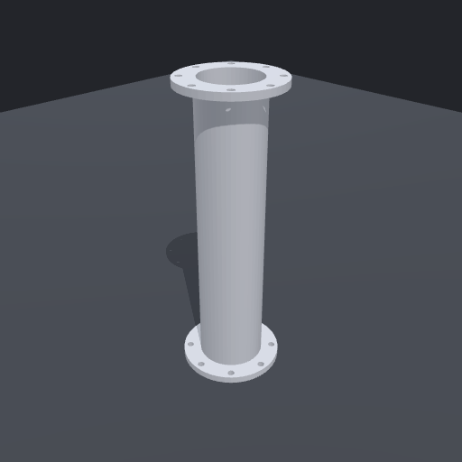](../src/moraine3d/docs/examples/flange_pipe/flange_pipe.star)<br>[flange_pipe](../src/moraine3d/docs/examples/flange_pipe/flange_pipe.star) | Through-bored pipe with two bolted flanges, one watertight solid; length and flange diameter asserted (`extent`). | cylinder, boolean | showcase |
| [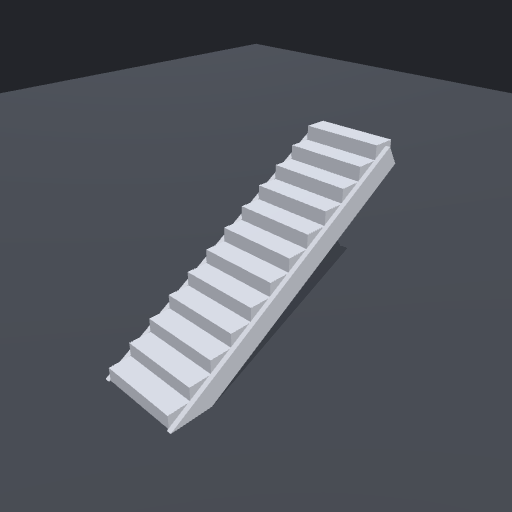](../src/moraine3d/docs/examples/stairs/stairs.star)<br>[stairs](../src/moraine3d/docs/examples/stairs/stairs.star) | Straight flight, instanced steps, stringers cut flush to the ground; rise, width, and riser count asserted (`extent`, `count`), and every step bearing on the stringers by face (`contact` with `min_area`). | array, boolean | showcase |
| [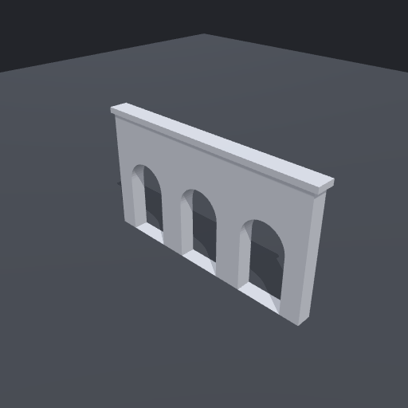](../src/moraine3d/docs/examples/arcade/arcade.star)<br>[arcade](../src/moraine3d/docs/examples/arcade/arcade.star) | Wall with three semicircular arches and a coping band, one watertight mesh. | boolean, cylinder | showcase |
| [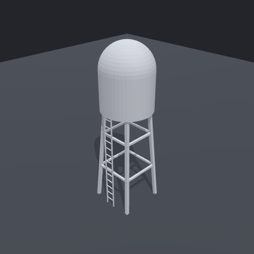](../src/moraine3d/docs/examples/water_tower/water_tower.star)<br>[water_tower](../src/moraine3d/docs/examples/water_tower/water_tower.star) | Tank with a hemispherical dome on a rotational array of tilted legs, braced, with an instanced-rung ladder. | sphere, array, boolean | showcase |
| [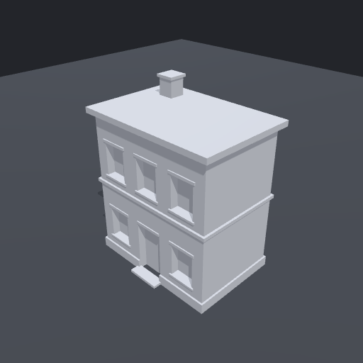](../src/moraine3d/docs/examples/brick_building/brick_building.star)<br>[brick_building](../src/moraine3d/docs/examples/brick_building/brick_building.star) | Boolean opening cuts, unioned trim, instanced sills and lintels. | boolean, array | showcase |
| [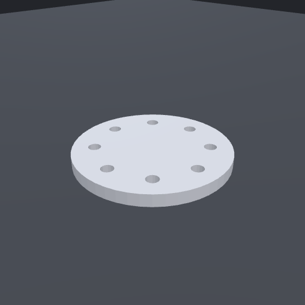](../src/moraine3d/docs/examples/bolt_plate/bolt_plate.star)<br>[bolt_plate](../src/moraine3d/docs/examples/bolt_plate/bolt_plate.star) | Eight bolt holes: rotational array → `bake_instances` → boolean difference. | array, bake_instances, boolean | operator (bake_instances) |
| [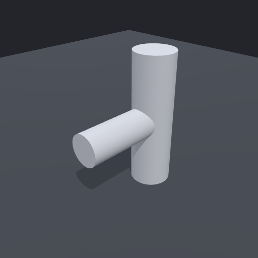](../src/moraine3d/docs/examples/pipe_tee/pipe_tee.star)<br>[pipe_tee](../src/moraine3d/docs/examples/pipe_tee/pipe_tee.star) | Two cylinders unioned, then angle-threshold auto-smoothed. | boolean, smooth_normals | operator (smooth_normals) |
| [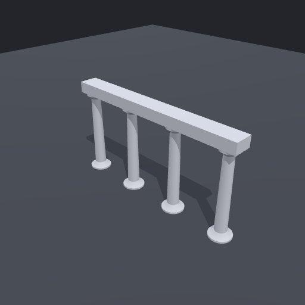](../src/moraine3d/docs/examples/turned_column/turned_column.star)<br>[turned_column](../src/moraine3d/docs/examples/turned_column/turned_column.star) | Revolved column profile; the capital tagged on the prototype, a colonnade of four, an architrave placed on copy 0 and asserted to rest on every column. | revolve, tag, array, place | operator (revolve) |
| [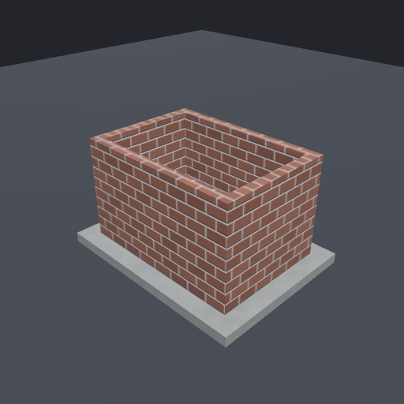](../src/moraine3d/docs/examples/brick_shed/brick_shed.star)<br>[brick_shed](../src/moraine3d/docs/examples/brick_shed/brick_shed.star) | Hollow brick walls placed on a concrete slab by its tagged top face; procedural brick albedo with a height-derived normal map, noise-based concrete; declared parameters. | brick_texture, normal_map, colorize, noise_texture, place, material | operator (brick_texture, colorize, normal_map) |
| [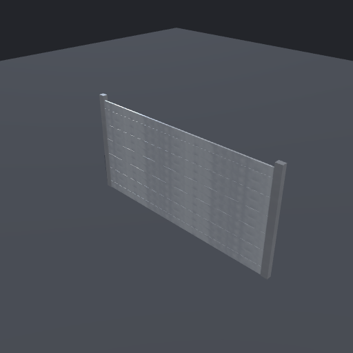](../src/moraine3d/docs/examples/steel_door/steel_door.star)<br>[steel_door](../src/moraine3d/docs/examples/steel_door/steel_door.star) | Louvred steel door in a frame; painted steel from a ramped noise and streak roughness; every slat asserted to be held by the frame. | ramp, streaks, noise_texture, material, array | operator (noise_texture, ramp, streaks); texture legibility patterns |
| [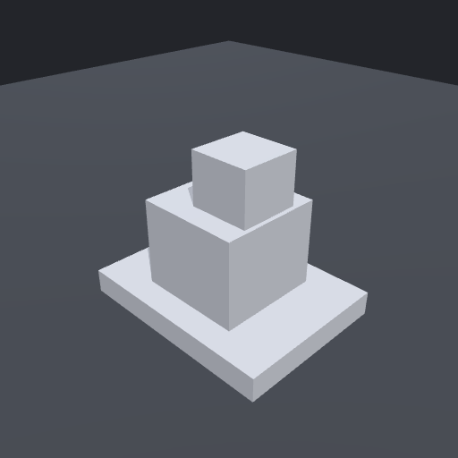](../src/moraine3d/docs/examples/anchored_crate/anchored_crate.star)<br>[anchored_crate](../src/moraine3d/docs/examples/anchored_crate/anchored_crate.star) | A crate placed on a pallet's tagged deck, a smaller crate on its lid; both rests asserted as `contact`. | tag, place | showcase (anchoring) |
| [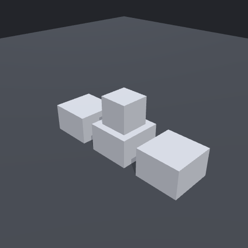](../src/moraine3d/docs/examples/shelf_row/shelf_row.star)<br>[shelf_row](../src/moraine3d/docs/examples/shelf_row/shelf_row.star) | Items placed on one copy of an instanced shelf by `instance` index. | tag, place, array | operator (place) |
| [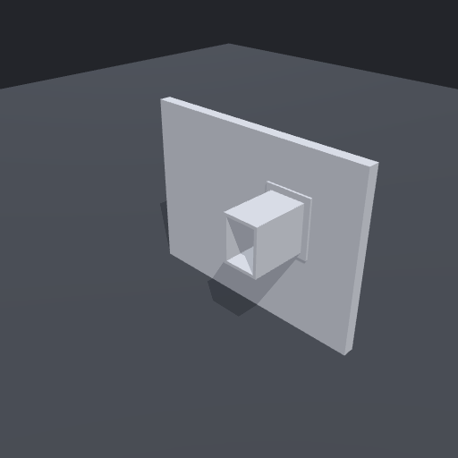](../src/moraine3d/docs/examples/wall_duct/wall_duct.star)<br>[wall_duct](../src/moraine3d/docs/examples/wall_duct/wall_duct.star) | A duct mated to a wall port face-to-face, with a flange riding the same solve; `mated` and `contact` asserted. | tag, mate, boolean | operator (mate) |
| [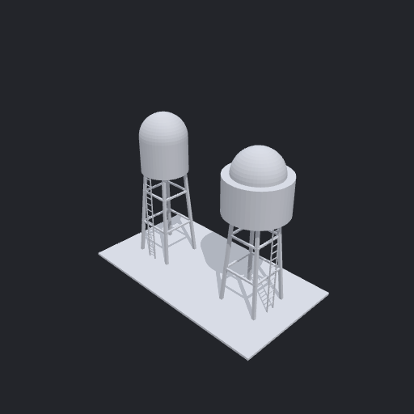](../src/moraine3d/docs/examples/tower_yard/tower_yard.star)<br>[tower_yard](../src/moraine3d/docs/examples/tower_yard/tower_yard.star) | A vendored water tower (`subassets/`) placed twice from one file, with one knob. | asset_ref, transform | operator (asset_ref); showcase |
| [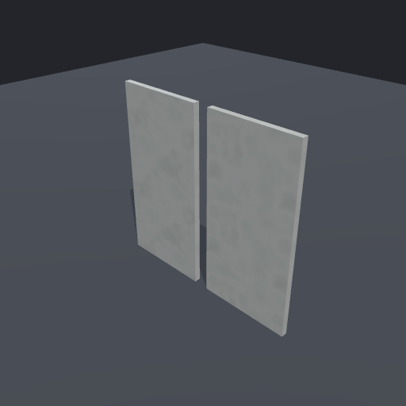](../src/moraine3d/docs/examples/kit_variants/kit_variants.star)<br>[kit_variants](../src/moraine3d/docs/examples/kit_variants/kit_variants.star) | One panel kit placed twice with parameter overrides and a per-use material identity, under a material budget. | asset_ref (overrides, material_rename) | operator (asset_ref); showcase |
| [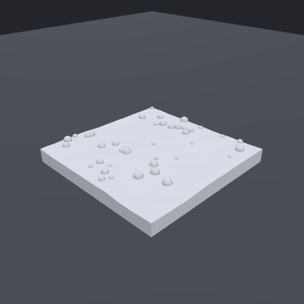](../src/moraine3d/docs/examples/scatter_field/scatter_field.star)<br>[scatter_field](../src/moraine3d/docs/examples/scatter_field/scatter_field.star) | A displaced grid extruded and cut into a ground slab, forty rocks scattered on it: every rock asserted to touch the ground, the sinks and the rock overlaps declared as free-overlap embeds, the count pinned. | grid, noise_displace, extrude, boolean, sphere, scatter | operator (grid, extrude, scatter, noise_displace, sphere) |
| [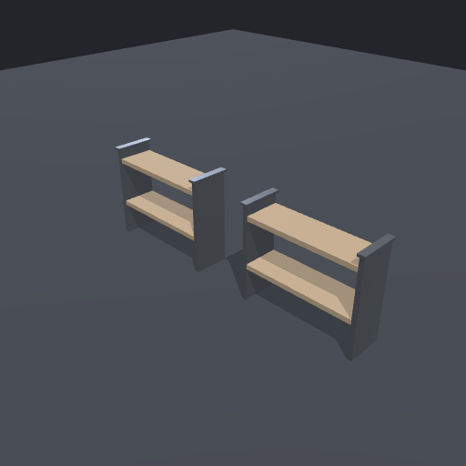](../src/moraine3d/docs/examples/shelf_pair/shelf_pair.star)<br>[shelf_pair](../src/moraine3d/docs/examples/shelf_pair/shelf_pair.star) | Two shelves, each a pair of capped posts and two boards (unwrap → material → array on both prototypes), named as output groups: each shelf kept clear of everything outside it, the shelves apart, a board end mated `contained` to its post, the cap height read from a tag only the cap can satisfy. | box, boolean, tag, unwrap, material, array | operator (tag); groups; assertions |

Operator semantics: `moraine docs <op>`, or
[src/moraine3d/docs/reference/ops.md](../src/moraine3d/docs/reference/ops.md).
Authoring conventions the assets follow: the modeling-agent guide,
[src/moraine3d/docs/guide.md](../src/moraine3d/docs/guide.md).
