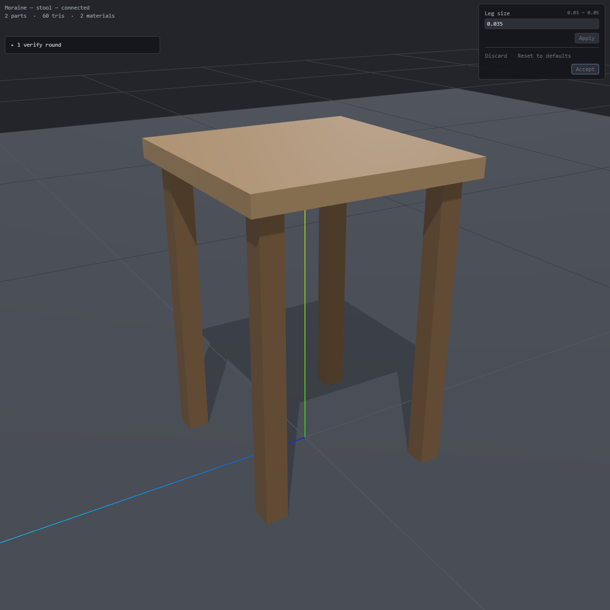

# ツアー: 最初のアセット

[English](tour.md) | 日本語

このツアーは README の[使い始める](../README.ja.md#使い始める)の続きです。`moraine` をインストールし、`moraine init` で作ったワークスペースをエージェントで開いて、アセットを 1 つ依頼からエクスポートまで行います。自分でやるのは、依頼を書くこと、結果を見ること、受け入れることです。あとはエージェントがやります。

## 1. ワークスペース

ワークスペースには複数のプロジェクトが入り、それぞれに専用のフォルダが作られます。プロジェクトのフォルダにはレシピ（`.star` ファイル）と、要件を書く要件ファイル `<name>.requirements.star` が配置されます。エージェントが作業を進めるなかで、`journal.md`、ツールの中間生成物を配置する `build/` フォルダ、エクスポートファイルを配置する `exports/` フォルダが追加されます。ワークスペース直下の `AGENTS.md` には、既定の寸法や作業言語など、どの依頼にも共通するルールを自分で書きます。

## 2. スツールを頼む

作りたいものを要件とともに、以下のように伝えてください。

> `stool` フォルダにスツールを作って。高さ 0.5 m、座面は 0.36 m 角、脚は 4 本でインスタンス化。座面の高さと、座面が 4 本の脚すべてに載っていることが要件。

エージェントは新しい `stool/` プロジェクトにレシピを書きます。ツールがレシピからメッシュを生成して検証し、エージェントはすべての要件が通るまでレシピを修正します。レシピを読む必要はありませんが、依頼した 2 つの要件が `stool/stool.requirements.star` にどう書かれたかは、一度見ておく価値があります。

```python
SEAT_H = 0.50
LEG_BEARING_MIN = 0.03 * 0.03

mo.assert_extent(id = "seat_height", outputs = ["seat"], measure = "max_y", value = SEAT_H)
mo.assert_contact(id = "seat_on_every_leg", outputs = ["legs", "seat"], every = ["legs"], min_area = LEG_BEARING_MIN)
```

これらのコードが、ツールが検証する要件です。高さは、依頼で言った数値そのままです。接触面積、つまり「載っている」と言えるために座面が各脚とどれだけ面を共有すべきかは、エージェントによる解釈で、エージェントはその数値を確認してきます。このファイルはあなたのもので、指示しない限りエージェントは変更しません。

## 3. ビューアで見る

エージェントが作業を始めると、ブラウザでビューアが開きます。開かなければ、エージェントに URL を聞いてください。ビューアには今のプロジェクトが表示され、その場でエージェントの編集に追従します。左上の検証ラウンドのパネルにはラウンドの一覧が並び、最新のラウンドが落ちている間は、失敗したチェックの名前が表示されます。右上のパネルは、あなたが調整できるようにエージェントが残した値（ここでは脚の太さ）の UI です。そこで値を変えて Apply ボタンを押すと、結果をプレビューできます。調整に納得できたら Accept ボタンを押してください。選んだ値がプロジェクトの `params.json` に保存され、ツールはその値で要件をもう一度検証します。レシピは変わりません。



変えたいところや、パネルに増やしたいパラメータがあれば、エージェントにそう伝えてください。ビューア上で、変えたい部品をピンで指して伝えることも可能です。エージェントがレシピを修正し、ツールが検証し直し、ビューアが追従します。何を完成とするかは、あなたが決めます。

## 4. エクスポートする

スツールの仕上がりが気に入ったら、エージェントに以下のように頼みます。

> スツールをエクスポートして。

エージェントがエクスポートを実行し、ツールが `stool/exports/stool.glb` を書き出します。部品、マテリアル、インスタンシングをそのまま保った glTF 2.0 ファイルで、マニフェストも一緒に出力されます。エクスポートには、検証が通っていることが必要です。マニフェストに記録された環境（Moraine のバージョンなど）が一緒なら、同じレシピからはバイト単位で同じファイルが出力されます。

エクスポートしたファイルは、glTF のインスタンシングに対応したビューアやエンジン（glTFast を入れた Unity など）で開いてください。対応していない場合は、インスタンスをベイクしてエクスポートするようエージェントに頼めます。

## 続きから再開する

エージェントは `stool/` プロジェクトに `journal.md` を残し、次のラウンドの前に読み返すので、前回の続きから始められます。

## サンプルワークスペースを見る

部品を組み立て、作り込み、拡張しながらラウンドごとに鉄道駅キットが育っていく様子を追えます。[サンプルワークスペース](https://github.com/ms-elk/moraine-sample-workspace)には、それぞれの判断の元になった依頼、レシピ、ジャーナルが揃っています。
